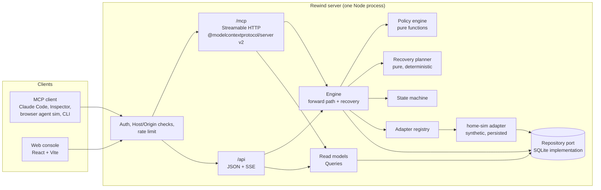

# Rewind

**Live: [getrewind.onrender.com](https://getrewind.onrender.com)** · no signup, nothing to install.

> **Judges:** my full submission write-up (description, testing steps, product feedback, friction log, video plan) is in [`docs/submission/`](docs/submission/README.md).

### Try it in 60 seconds

1. Open the site and type (or say) your own request in **Ask your home**, for example *"turn the heat down to 18, remind me to water the plants, then lock up"*.
2. **Run it.** A real MCP agent carries out each step through Rewind, and the last step is made to fail on purpose.
3. Watch Rewind stop, undo the earlier steps newest-first, and **read every resource back** to prove it was restored.
4. Try **Tell the family**: a message needs your approval, and can't be unsent, so Rewind tells you exactly that instead of claiming a rollback.
5. Try **Try something risky**: the default policy blocks *disarm* before anything happens.


**AI can make mistakes. Rewind makes those mistakes visible, contained and recoverable, whenever recovery is actually possible.**

Rewind is an execution-control layer between a tool-using AI agent and the tools it is allowed to use. It records the state of every resource before an agent changes it, executes operations only through registered adapters, halts on the first failure, runs registered compensating actions in reverse dependency order, and then **reads every resource back to verify** that it was restored. When an effect cannot be undone, such as a sent message, Rewind says so instead of pretending.

It ships as a complete product: a landing page, accounts (or a one-click guest workspace), guided onboarding, a self-hosted **MCP server (Streamable HTTP, MCP protocol 2025-11-25)** with per-workspace API keys, a console for investigating and recovering executions, and a deterministic demo that needs no third-party keys or model access.

> A language model saying "I'll undo that" is not proof that anything was undone. Rewind treats restoration as a claim that has to be verified.

---

## What it demonstrates

A simulated assistant receives:

> *"Prepare the house for the weekend. Switch the thermostat to away mode, update the household task list, and activate the security routine."*

1. A real MCP client connects to `/mcp`, discovers the tools and opens an execution.
2. `thermostat.set_mode` and `tasks.update` succeed. Rewind captured each resource **before** and **after** the change.
3. `security.activate_routine` fails through a deliberately injected, deterministic fault (`SECURITY_HUB_REJECTED`).
4. The engine halts forward progress, plans recovery from the declared capabilities, and compensates `tasks.update`, then `thermostat.set_mode`. Each compensation re-checks the resource version first and refuses to overwrite a change made by someone else.
5. It reads both resources back and compares them to the captured originals. Both match, so they are **recovered and verified**.
6. The security routine never activated, so it is reported as **not required**: there is nothing to reverse.

Everything above goes through the backend and is persisted in SQLite. Nothing is faked in browser state.

### Recovery outcomes Rewind distinguishes

| Outcome | Meaning |
|---|---|
| **Recovered · verified** | A registered compensation ran and reading the resource back matched the captured original. |
| **Recovery pending** | Compensation started; not yet verified. |
| **Recovery failed** | Compensation was attempted, but restoration could not be verified (handler error, or read-back mismatch). |
| **Recovery unavailable** | The operation is declared irreversible or has no registered strategy. The effect remains. |
| **Needs manual review** | The resource changed after Rewind wrote it, or an unknown outcome could not be reconciled. Rewind will not guess. |
| **Not required** | The step had no effect (a read, a step that never ran, or a failure that provably changed nothing). |

The difference between *true rollback* (the target system offers transactional rollback) and *compensation* (a separate operation that restores business state) is part of each operation's declaration. See [docs/recovery-semantics.md](docs/recovery-semantics.md).

---

## Quick start

**Prerequisites:** Node.js 22.13 or later (developed on Node 24). No database server, Docker or third-party accounts are needed.

```bash
npm install
npm run demo
```

`npm run demo` builds the console and starts the server. Then:

- Home: <http://127.0.0.1:4747/>. Click **Try the live demo, no signup** for an instant guest workspace, or **Create a workspace**.
- MCP endpoint: `http://127.0.0.1:4747/mcp` (Streamable HTTP)

Onboarding walks through it in four steps: name the workspace, watch a failure get rewound (an animated replay of the recorded events), create an API key and connect an agent (the page detects the agent's first MCP call live), and finish. In the console, **Agent demo → Run agent via MCP** runs the signature scenario from an in-browser MCP client. **⌘K / Ctrl+K** opens the command palette.

To drive the same workflow from a terminal with the official MCP SDK client, create a key in **Settings → API keys**, then:

```bash
REWIND_API_KEY=rwk_… npm run demo:mcp
```

### Development

```bash
npm run dev        # API + MCP server with file watching (port 4747)
npm run dev:web    # Vite dev server for the console (port 5173, proxies /api and /mcp)
```

### Database

SQLite (Node's built-in `node:sqlite`) with versioned, forward-only migrations applied on start.

```bash
npm run db:migrate   # apply pending migrations and list applied versions
npm run db:reset     # delete the local DB and recreate it from migrations + deterministic seed
```

The console's **Reset demo** control restores the synthetic home to its seed, optionally with full history deletion. It asks for confirmation and records the deletion as an audit event.

---

## Connect an MCP client

| | |
|---|---|
| URL | `http://127.0.0.1:4747/mcp` |
| Transport | Streamable HTTP, stateless (one server instance per request) |
| Protocol | `2025-11-25`, negotiated by the official v2 client and covered by the test suite. The SDK also accepts earlier 2025 revisions, and its `2026-07-28` handling is untested here. |
| Auth | Workspace API key: `Authorization: Bearer rwk_…` (create in Settings). The console's own session cookie also works for the in-browser agent. |

**Claude Code**

```bash
claude mcp add --transport http rewind http://127.0.0.1:4747/mcp --header "Authorization: Bearer $REWIND_API_KEY"
```

**Generic client configuration**

```json
{ "mcpServers": { "rewind": { "type": "http", "url": "http://127.0.0.1:4747/mcp", "headers": { "Authorization": "Bearer ${REWIND_API_KEY}" } } } }
```

**MCP Inspector**

```bash
npx @modelcontextprotocol/inspector
```

Choose *Streamable HTTP*, enter the URL above and add the `Authorization` header.

### Tools

| Tool | Purpose |
|---|---|
| `list_operations` | Registered operations with input schemas, recovery capability, permissions and the current policy decision |
| `create_execution` | Open an execution; optional pre-declared plan; idempotency key |
| `execute_registered_action` | Run one registered operation as the next step, after policy checks; `dedupe_key` prevents repeated mutations |
| `run_execution` | Advance a pre-declared plan |
| `complete_execution` | Close an agent-driven execution |
| `get_execution` | Status, steps and recovery summary |
| `list_executions` | Bounded, filtered, cursor-paginated history |
| `get_execution_trace` | Ordered audit timeline |
| `request_recovery` | Idempotent recovery request (`request_key`) |
| `get_recovery_status` | Per-step outcomes, verification results, unresolved side effects |
| `get_resource_state` | Read a resource through a registered, policy-allowed read operation |

There is deliberately **no** MCP tool to approve a step, edit policy, inject faults or reset data. Those are human controls in the console. Full reference: [docs/mcp.md](docs/mcp.md).

---

## Architecture



| Layer | Location |
|---|---|
| Presentation | `web/src` (React, Tailwind v4, React Router) |
| Transport | `src/http/server.ts` (API, SSE, MCP mount), `src/mcp/tools.ts` (MCP tools) |
| Application services | `src/services` (composition root, read models, scenarios, reports) |
| Domain | `src/domain` (state machine, policy, recovery planning, errors, redaction) |
| Orchestration | `src/engine` (execution and recovery engine, timeouts) |
| Adapters | `src/adapters` (contract, registry, `home-sim`) |
| Persistence | `src/persistence` (migrations, async repository port, SQLite implementation) |

More detail and design decisions: [docs/architecture.md](docs/architecture.md).

---

## Configuration

All configuration is environment variables. See [.env.example](.env.example).

| Variable | Default | Purpose |
|---|---|---|
| `REWIND_HOST` | `127.0.0.1` | Bind address. Any non-loopback value requires `REWIND_ALLOWED_HOSTS`; the server refuses to start otherwise. |
| `REWIND_PORT` | `4747` | Port for the console, API and MCP. |
| `REWIND_DB_PATH` | `./data/rewind.db` | SQLite file. |
| `REWIND_ENVIRONMENT` | `local-demo` | Label recorded on every execution. |
| `REWIND_ALLOWED_HOSTS` | unset | Hostnames accepted in `Host` and `Origin` off loopback. `*` disables the check (only behind a trusted front door such as AgentCore). |
| `REWIND_COOKIE_SECURE` | `auto` | `Secure` session cookies: `auto` (when HTTPS), `true` or `false`. |
| `REWIND_TRUST_UPSTREAM_AUTH` | `none` | `agentcore`: accept MCP calls already authenticated by Amazon Bedrock AgentCore Runtime. |
| `REWIND_RETENTION_DAYS` | `30` | Finished executions older than this are purged hourly. |
| `REWIND_GUEST_RETENTION_HOURS` | `48` | Guest workspaces are deleted, with their history, after this many hours. |
| `REWIND_LOG_LEVEL` | `info` | `debug`, `info`, `warn`, `error` or `silent`. JSON-lines logs with redaction. |
| `REWIND_DEMO_TIMEOUT_MS` | `1500` | Per-operation timeout for the demo adapter. |
| `REWIND_PUBLIC_URL` | `http://host:port` | Base URL used in invitation and password-reset links. |
| `REWIND_METRICS_TOKEN` | unset | Bearer token for `/metrics` when not on loopback. |
| `REWIND_ALLOW_PRIVATE_WEBHOOKS` | `true` on loopback | Allow `http://` and private-address webhook targets (development only). |

---

## Testing

```bash
npm test             # unit + integration (Vitest): engine, adapter, SQLite, MCP over real HTTP
npm run test:e2e     # browser end-to-end (Playwright) against a real server on a throwaway DB
npm run typecheck    # strict TypeScript for server and console
```

The end-to-end suite uses the locally installed Microsoft Edge by default, so no browser download is needed. Set `PW_CHANNEL=chromium` after `npx playwright install chromium`, or `PW_CHANNEL=chrome`, to use another browser.

Covered adversarial cases: failure before any mutation, after one and after several mutations, a failing compensation handler and a safe retry, a resource changed between snapshot and compensation, dependency-aware blocking, repeated and concurrent recovery requests, a timeout with unknown outcome (no blind retry, read-back reconciliation), irreversible actions, a compensation that lies (verification catches it), invalid and unregistered tool calls, prohibited actions, conflicting executions on one resource, crash and restart reconciliation, append-only audit enforcement, idempotency conflicts, workspace boundaries, bearer auth, and cross-origin rejection.

---

## Write an adapter

An adapter declares, in code, what each operation does and how it can be recovered. Registration validates those declarations: for example, a `compensatable` operation without a handler, or an `irreversible` one with a handler, fails at startup. See [docs/adapters.md](docs/adapters.md) and the working example in [src/adapters/home-sim/adapter.ts](src/adapters/home-sim/adapter.ts).

An action counts as recoverable only if:

1. it declares `compensatable` or `rollback` and registers a handler;
2. its resource can be read, so the original state is captured before the change;
3. its write reports the resulting version, so compensation can refuse to overwrite a later change;
4. after compensation, reading the resource back matches the captured original.

---

## Teams, roles, keys and integrations

- **Roles:** owner, admin, member and viewer, enforced on the server for every API and MCP call. Members run agents and request recovery; **approving a gated step needs an admin** (separation of duties). Viewers are read-only, and their MCP sessions too.
- **Invitations:** one-time links valid for 7 days, optionally emailed. People join through `/invite/<token>`, and the workspace switcher in the user menu lists every workspace they belong to.
- **Account security:** change your password (other sessions are signed out), reset a forgotten one with a one-use 30-minute link, see and revoke active sessions, or upgrade a guest workspace to a permanent account in place.
- **Webhooks:** signed (HMAC-SHA256) notifications for `execution.needs_attention`, `execution.recovered`, `execution.failed`, `execution.succeeded` and `approval.requested`, with retries, a delivery log and SSRF protection. See [docs/webhooks.md](docs/webhooks.md).
- **Audit log:** a workspace-wide, append-only page of every admin, access, approval and recovery event.
- **Usage:** per-month counts of executions, MCP-driven executions, verified and failed recoveries, and approvals, from stored records. Rewind is self-hosted and has no billing.


- **Sign up** with a name, email and password (scrypt, N=2^15, per-user salt), or **continue as guest** for a temporary workspace that is deleted automatically.
- Every account gets its own **workspace**: its own synthetic home, default policies, executions, audit log and API keys. Every query, adapter call and resource lock is scoped by the workspace of the credential, never by client input.
- **Sessions** are random 256-bit tokens in an `httpOnly`, `SameSite=Lax` cookie. **API keys** (`rwk_…`) are shown once. Only the SHA-256 of either is stored. Keys can be revoked instantly, and a key cannot mint more keys.
- **Activation metrics** (time to first execution, first verified recovery, first MCP call) are measured from real events and stay local; see Settings.

## Operations

`/healthz`, `/readyz` and Prometheus `/metrics`, request IDs, structured logs, a strict CSP and security headers, compression, immutable asset caching, a Docker `HEALTHCHECK`, and a GitHub Actions CI pipeline (typecheck, unit/integration, build, dependency audit, Playwright). See [docs/operations.md](docs/operations.md).

## Security

- Policy is enforced in the engine on the server before every mutation, with default deny. Prohibited operations never run, with or without approval.
- Only registered adapter operations can execute. There is no shell, filesystem, URL fetch or code-execution tool, and caller-supplied operation names never reach dynamic dispatch.
- Every tool input is strictly validated (Zod, `.strict()`), and outputs are bounded.
- On loopback, `Host` and `Origin` headers are validated on every route (DNS-rebinding and CSRF protection); off loopback an explicit host allow-list is required. Every API and MCP request is authenticated, with stricter rate limits on sign-in endpoints.
- The workspace comes from the credential; clients cannot choose it.
- Payloads, audit events and logs pass through key-based redaction, and payloads are capped at 64 KB.
- Audit events are append-only: the database refuses `UPDATE` and `DELETE` via triggers, except during the explicit, confirmed purge.

Limitations and the threat model: [docs/security.md](docs/security.md).

---

## Limitations (honest list)

- **Not an Alexa+ integration.** The browser "voice" agent is a labelled simulation: typed text, a deterministic keyword planner and no LLM. The MCP traffic is real. The core engine has no Alexa-specific code, so an Alexa+ or other MCP-capable host can call the same tools.
- **Synthetic devices only.** The `home-sim` adapter controls no real thermostat, Ring device, account or home.
- **No email provider, SSO or MFA yet.** Invitations and password resets work, but the default mailer writes messages to the server log instead of sending them (invite links can be copied from the console). There is no SSO, MFA or per-account lockout. **Single process:** Resource leases and the per-execution mutex protect one process (SQLite file locking covers one host). Multiple instances would need a shared lock service.
- **SQLite only.** The repository is an async port so a PostgreSQL implementation can be added without touching domain or engine code, but none exists yet. `node:sqlite` still prints an experimental warning on some Node versions, which the scripts suppress.
- **Stateless MCP.** No server-initiated streams, sampling or elicitation. A `GET /mcp` returns 405, as the transport allows.
- **Integrity hashes are not a seal.** Snapshots and audit payloads carry SHA-256 digests that detect accidental corruption. They are not a tamper-proof chain.
- **AWS deployment is prepared, not done.** The AgentCore-compatible image and upstream-trust mode are implemented and tested locally; the deployment itself needs AWS credentials. See [docs/deploy-aws.md](docs/deploy-aws.md).

---

## Repository layout

```
src/
  adapters/            adapter contract, registry, home-sim demo adapter
  domain/              state machine, policy, recovery planner, errors, redaction
  engine/              execution + recovery engine, timeouts
  http/                Express server: API, SSE, MCP mount, auth, rate limit
  mcp/                 MCP tool definitions
  persistence/         migrations, repository port, SQLite implementation
  services/            composition root, accounts, read models, scenarios, reports, retention
  main.ts              entry point (graceful shutdown, retention timer)
web/src/               landing, auth, onboarding and console (pages, components, typed API client, agent simulation)
tests/                 Vitest unit + integration
e2e/                   Playwright end-to-end
scripts/               mcp-demo (CLI MCP client), db (migrate/reset)
docs/                  architecture, recovery semantics, MCP, adapters, security, demo script, AWS
```

## Contributing

See [CONTRIBUTING.md](CONTRIBUTING.md) and [CODE_OF_CONDUCT.md](CODE_OF_CONDUCT.md). Licensed under the [MIT License](LICENSE).
