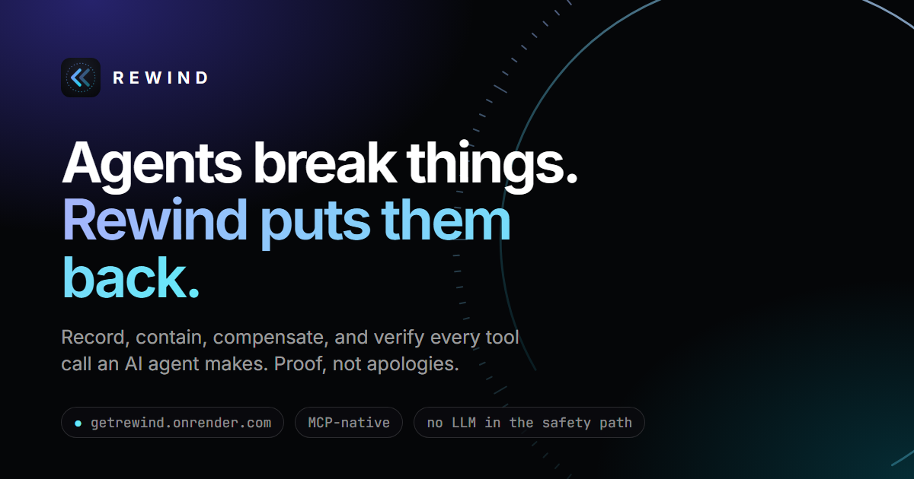
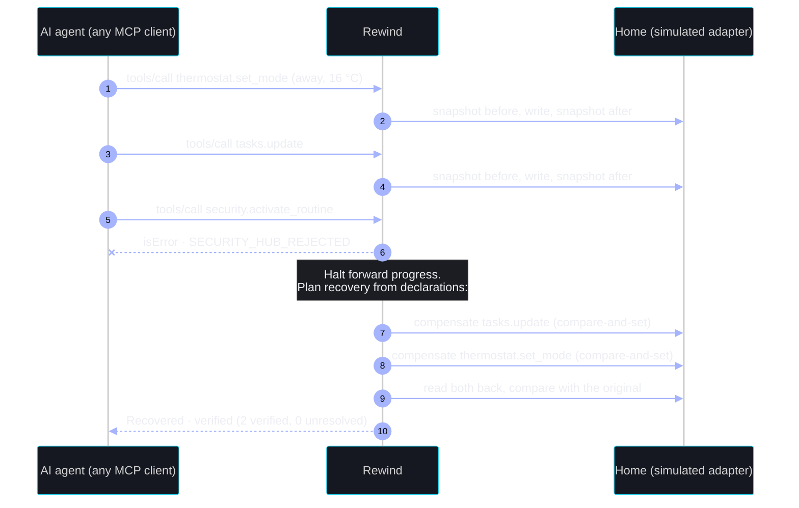
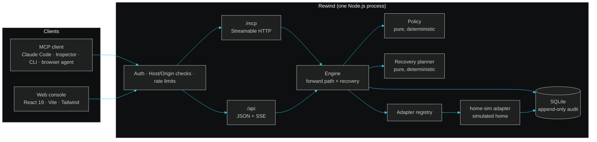

<div align="center">


# Rewind

### Undo for AI agents, with proof.

An MCP-native execution layer that records every change an AI agent makes, contains the first failure,<br/>
compensates in reverse order, and **reads every resource back to prove it was restored**.

[](https://getrewind.onrender.com)


<br/>

<a href="https://getrewind.onrender.com"></a>

</div>

<br/>

> A language model saying *"I'll undo that"* is not proof that anything was undone.
> **Rewind treats restoration as a claim that has to be verified.**

## The problem

An agent gets one request and makes three changes across three systems. The third one fails. The first two already happened. Retrying won't fix it, the model can't be trusted to clean up after itself, and nobody can say for sure what is still wrong.

Rewind sits between the agent and its tools. Every write goes through it, so when something breaks there is a recorded answer, a deterministic recovery, and a verified result.



## Try it in 60 seconds

**[getrewind.onrender.com](https://getrewind.onrender.com)**: no signup, nothing to install.

1. **Type or say** a request in *Ask your home*, for example *"turn the heat down to 18, remind me to water the plants, then lock up"*.
2. **Run it.** A real MCP agent carries out each step through Rewind, and the last step fails on purpose.
3. **Watch it rewind.** Rewind stops, undoes the earlier steps newest-first, and reads every resource back to prove it.
4. **Tell the family:** a message needs your approval and can't be unsent, so Rewind reports it as *recovery unavailable* instead of pretending.
5. **Try something risky:** the default policy blocks *disarm* before anything happens.

## How it works

| | Step | What Rewind does |
|:-:|---|---|
| **1** | **Check** | Every step is evaluated against policy (allow, require approval, deny) at execution time. Recovery capability comes from the adapter's declaration, never from the model. |
| **2** | **Record** | Takes a lease on the resource, persists a *before* snapshot, executes through the adapter with a timeout, then persists the result and an *after* snapshot. |
| **3** | **Contain** | Stops at the first failure. An unknown outcome is never retried blindly; it is reconciled by reading the resource back. |
| **4** | **Compensate** | Runs the registered compensations in reverse dependency order. Each one is compare-and-set, so it refuses to overwrite a change someone else made. |
| **5** | **Verify** | Reads every resource back and compares it with the original snapshot. Only an exact match counts as **recovered · verified**. |

### Honest outcomes

| Outcome | Meaning |
|---|---|
| 🟢 **Recovered · verified** | A compensation ran and the read-back matched the captured original. |
| 🔵 **Recovery pending** | A compensation started and isn't verified yet. |
| 🔴 **Recovery failed** | A compensation was attempted, but restoration couldn't be verified. |
| 🟠 **Recovery unavailable** | The operation is irreversible (a sent message, say). The effect remains, and Rewind says so. |
| 🟡 **Needs manual review** | The resource changed after Rewind wrote it. Rewind won't guess. |
| ⚪ **Not required** | The step had no effect, so there is nothing to reverse. |

## Architecture

One Node.js process serves the MCP endpoint, a JSON API with server-sent events, and the web console. Every surface goes through the same engine and read models.



| Layer | Location |
|---|---|
| Presentation | `web/src`: landing page, onboarding, console, voice, agent simulation |
| Transport | `src/http/server.ts` (API, SSE, MCP mount), `src/mcp/tools.ts` (MCP tools) |
| Domain (pure) | `src/domain`: state machine, policy, recovery planner, errors, redaction |
| Orchestration | `src/engine`: execution and recovery engine, timeouts |
| Adapters | `src/adapters`: contract, registry, `home-sim` |
| Persistence | `src/persistence`: migrations, repository port, SQLite |

More detail: [docs/architecture.md](docs/architecture.md) · writing your own adapter: [docs/adapters.md](docs/adapters.md)

## Connect an MCP client

| | |
|---|---|
| Endpoint | `https://getrewind.onrender.com/mcp`, or `http://127.0.0.1:4747/mcp` locally |
| Transport | Streamable HTTP (stateless) |
| Protocol | `2025-11-25` |
| Auth | Workspace API key: `Authorization: Bearer rwk_…` (create one in **Settings → API keys**) |

```bash
claude mcp add --transport http rewind https://getrewind.onrender.com/mcp --header "Authorization: Bearer $REWIND_API_KEY"
```

<details>
<summary><b>The 11 tools</b></summary>

| Tool | Purpose |
|---|---|
| `list_operations` | Registered operations, input schemas, recovery capability, permissions and current policy decision |
| `create_execution` | Open an execution, with an optional pre-declared plan and an idempotency key |
| `execute_registered_action` | Run one registered operation as the next step, after policy checks |
| `run_execution` | Advance a pre-declared plan |
| `complete_execution` | Close an agent-driven execution |
| `get_execution` | Status, steps and recovery summary |
| `list_executions` | Filtered, cursor-paginated history |
| `get_execution_trace` | Ordered audit timeline |
| `request_recovery` | Idempotent recovery request |
| `get_recovery_status` | Per-step outcomes, verification results, unresolved side effects |
| `get_resource_state` | Read a resource through a registered, policy-allowed read |

There is deliberately **no** tool to approve a step, edit policy, inject faults or reset data. Those are human controls in the console. Agents can never approve their own actions.

</details>

To drive the whole failure-and-recovery flow from a terminal with the official MCP SDK client:

```bash
REWIND_API_KEY=rwk_… npm run demo:mcp -- --url https://getrewind.onrender.com/mcp
```

## Run it locally

You need Node.js 24 (22.13 or later works). There's no database server, Docker or third-party account to set up.

```bash
git clone https://github.com/antonettesk/rewind && cd rewind
npm ci
npm run demo        # builds the console and starts http://127.0.0.1:4747
```

<details>
<summary><b>Development, database and configuration</b></summary>

```bash
npm run dev          # API + MCP server with file watching (port 4747)
npm run dev:web      # Vite dev server for the console (port 5173)
npm run typecheck    # strict TypeScript for server and console
npm run db:migrate   # apply pending migrations
npm run db:reset     # recreate the local DB from migrations + deterministic seed
```

All configuration is environment variables; see [.env.example](.env.example). The main ones:

| Variable | Default | Purpose |
|---|---|---|
| `REWIND_HOST` / `REWIND_PORT` | `127.0.0.1` / `4747` | Bind address and port. Any non-loopback host requires `REWIND_ALLOWED_HOSTS`. |
| `REWIND_DB_PATH` | `./data/rewind.db` | SQLite file. |
| `REWIND_ALLOWED_HOSTS` | unset | Hostnames accepted in `Host` and `Origin` off loopback. |
| `REWIND_TRUST_PROXY` | `0` | Reverse-proxy hops to trust (Render: `1`). |
| `REWIND_SECRET_KEY` | generated | 32 random bytes, base64. Encrypts MFA seeds at rest. |
| `REWIND_RESEND_API_KEY` | unset | Send invitation and reset emails through Resend; otherwise they're logged. |
| `REWIND_METRICS_TOKEN` | unset | Bearer token for `/metrics` off loopback. |

</details>

## Deploy

- **Render:** `render.yaml` is a ready Blueprint (Starter plan, persistent disk, health check). Secrets such as `REWIND_SECRET_KEY` and `REWIND_METRICS_TOKEN` are generated by Render, and `REWIND_RESEND_API_KEY` is entered in the dashboard. None of them are in the repository.
- **Amazon Bedrock AgentCore Runtime:** the `Dockerfile` builds an image that serves MCP on `0.0.0.0:8000/mcp`, and trusts AgentCore's upstream authentication (`REWIND_TRUST_UPSTREAM_AUTH=agentcore`).
- **AWS features (optional):** Amazon Nova planning on Bedrock and Amazon Polly voice reports are built in, with daily cost caps. They turn on when AWS credentials and `REWIND_AWS_REGION` are set. They're off on the live demo because the AWS account was locked during identity verification; see [docs/friction-log.md](docs/friction-log.md). Implementation: [docs/aws-features.md](docs/aws-features.md), the least-privilege policy [docs/aws-iam-policy.json](docs/aws-iam-policy.json), and the AgentCore guide [docs/deploy-aws.md](docs/deploy-aws.md).

## Security

- **Policy:** enforced in the engine before every mutation, with default deny. Prohibited operations never run.
- **Adapters only:** only registered adapter operations can execute. There's no shell, filesystem, URL fetch or code-execution tool.
- **Validated I/O:** every tool input is strictly validated (Zod `.strict()`), and outputs are bounded.
- **Workspace isolation:** the workspace comes from the credential, never from client input.
- **Sessions and keys:** sessions and API keys are random tokens, and only their SHA-256 is stored. Passwords use scrypt. Two-factor sign-in and SSO are available.
- **Request checks:** `Host` and `Origin` are validated on every route. A strict CSP and security headers are set, and sign-in endpoints are rate-limited.
- **Redaction:** logs and audit payloads are redacted.
- **Append-only audit:** the database refuses `UPDATE` and `DELETE` on audit events.

## Honest limitations

- **A simulation, not Alexa+.** The voice assistant is a browser simulation that controls no real device; the home is synthetic data. The MCP traffic and every tool call are real.
- **Restoration is checked against the declared view.** Rewind verifies the restoration view an adapter declares. It can't see downstream effects an adapter doesn't model, and it can't make an irreversible effect reversible.
- **One process, SQLite.** Leases and locks protect a single process. The repository is an async port, so a Postgres implementation can be added later.
- **Hashes catch accidents, not tampering.** Snapshot digests detect accidental corruption; they are not a tamper-proof seal.

## Documentation

| | |
|---|---|
| [Architecture](docs/architecture.md) | Boundaries, forward path, recovery path, concurrency |
| [Adapters](docs/adapters.md) | The adapter contract and how to write your own |
| [Testing instructions](docs/testing-instructions.md) | How to test the live demo, step by step |
| [Friction log](docs/friction-log.md) | What was hard while building it |

<div align="center">
<br/>

<br/>
<sub><b>Rewind</b> · Undo for AI agents, with proof · <a href="LICENSE">MIT License</a> · <a href="THIRD_PARTY_NOTICES.md">Third-party notices</a></sub>
</div>
