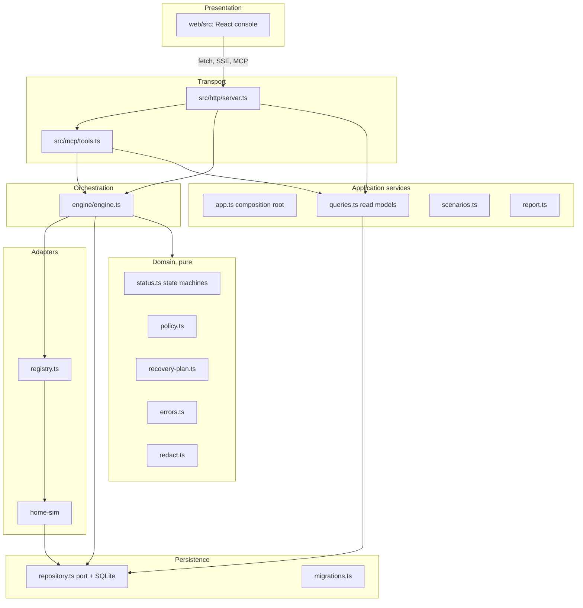
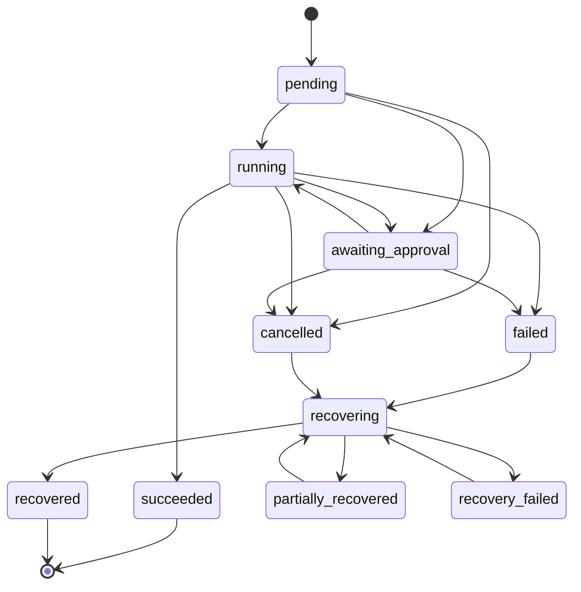

# Architecture

REWIND is one Node.js process that serves three surfaces on one port: the MCP endpoint (`/mcp`), a JSON API with server-sent events (`/api`), and the built web console. Everything shares one composition root (`src/services/app.ts`), so MCP tools, HTTP routes and the console all go through the same engine and read models.

## Boundaries

Rules the code follows:

- **Domain modules are pure.** `status.ts`, `policy.ts` and `recovery-plan.ts` have no I/O and are unit-tested in isolation. Every safety-relevant decision (may this run, does it need approval, is it eligible for compensation, in what order, is a retry safe, what is the final outcome) is a function of persisted records and declarations.
- **The engine is the only writer of execution state.** It calls `assertTransition` through `Repository.transitionExecution`, which also performs an optimistic version check inside a transaction.
- **Adapters are the only path to side effects.** The registry resolves `adapterId` and `operation` against registered definitions; unknown names fail with `UNKNOWN_OPERATION` before anything is persisted.
- **Read models are shared.** `Queries.executionView` derives per-step recovery outcomes, unresolved side effects and retry availability (using the same planner the engine uses). The console, the MCP tools and the exported report all render from it.
- **The UI keeps no execution engine.** It renders server responses and subscribes to `/api/events` (SSE) to refresh.

## Forward path

For each step:

1. Re-evaluate policy at execution time (rules may have changed since planning). Outcomes are `deny` (step denied, execution fails), `require_approval` (execution pauses at `awaiting_approval`), or `allow`.
2. Acquire a lease on the step's resource (`resource_locks`). If another active execution holds it, the step fails with `RESOURCE_LOCKED`, `effect: none`.
3. Read the resource and persist a `before` snapshot. If it cannot be read, the step does not run.
4. Execute with a timeout. Retry only errors that are explicitly `retryable` **and** `effect: none`, within the `maxForwardRetries` budget.
5. On success, persist the result and an `after` snapshot.
6. On failure:
   - `effect: none`: the step is `failed`.
   - Timeout, unclassified error, or `effect: applied`/`unknown`: the step is `outcome_unknown` and is **never retried blindly**.
   - Remaining planned steps are `skipped`, the execution becomes `failed`, and recovery starts automatically if policy allows.

## Recovery path

1. Refuse duplicates: the same `request_key` is a no-op, a concurrent request loses the optimistic version race (`RECOVERY_IN_PROGRESS`), and a fully recovered execution cannot be recovered again.
2. Reconcile every `outcome_unknown` step by reading the resource back:
   - `not_applied` if it equals the `before` snapshot at the same version;
   - `applied` if it equals the operation's `expectedAfter(before, input)`;
   - otherwise `inconclusive`, which goes to manual review.
3. Plan with `planRecovery`: decide each step, then order compensations in **reverse dependency order** (topological order of `dependsOn`, reversed; `null` means "depends on the previous step", `[]` means independent).
4. For each compensation:
   - capture a `pre_compensation` snapshot and compare its version with the version REWIND's own write produced (`writtenVersion`); if they differ, record `conflict` and do not write;
   - call the handler with a timeout (adapters also compare-and-set);
   - read the resource back, persist a `verification` snapshot, and compare to `before` → `verified` or `unverified`.
   If a step is not verified, its transitive dependencies are **not** compensated, because the surviving effect may rely on them.
5. Roll up: all needed effects verified → `recovered`; some → `partially_recovered`; none → `recovery_failed`. Unresolved side effects are listed explicitly.

## State machines

Execution:

`recovered` is added to the brief's minimum set. It is the only state that means every effect needing recovery was compensated **and verified**.

Actions: `planned → running → succeeded | failed | outcome_unknown`, plus `awaiting_approval`, `denied` and `skipped`. Recovery attempts: `running → verified | unverified | failed | conflict | interrupted`.

## Persistence

`src/persistence/migrations.ts` holds versioned, forward-only migrations recorded in `schema_migrations`. Tables: `workspaces`, `executions`, `actions`, `payloads` (redacted, size-capped, content-hashed), `state_snapshots`, `recovery_requests`, `recovery_attempts`, `policies`, `resource_locks`, `audit_events` (append-only via triggers), `maintenance`, and the demo adapter's `sim_resources` / `sim_faults`.

The `Repository` interface is fully async, and operations that must be atomic (transition with version check, idempotent create, lock acquisition, purge) are single methods. A PostgreSQL implementation would implement the same interface with real transactions and row locks. The domain and engine would not change.

## Concurrency model and its limits

- **Within an execution:** a per-execution async mutex serializes engine operations in this process.
- **Across executions:** resource leases in SQLite give single-writer-per-resource while an execution is in its forward or recovery phase. Leases are released when the execution halts or finishes.
- **Across time:** compensation is guarded by version checks, so a change made after REWIND's write is never overwritten.
- **Not provided:** distributed locking across multiple server processes or hosts. SQLite's file lock serializes writers on one host only. A multi-instance deployment needs a shared database with row-level locks or a lease service.

## Restart behaviour

On start, `Engine.reconcileInterrupted` finds anything left `running` or `recovering`. Running actions become `outcome_unknown`, running attempts become `interrupted`, the execution moves to `failed` or `recovery_failed`, leases are released, and a `system.interrupted` audit event is written. Nothing is left claiming progress it cannot prove.

## Design decisions

| Decision | Why | Trade-off |
|---|---|---|
| One process, Express 5, Vite SPA served by the API | Smallest thing that runs with one command; no SSR needed | Not Next.js (the brief's preferred stack); simpler to run and test |
| `node:sqlite` instead of a native driver | Zero native build on Windows/macOS/Linux | Experimental warning on some Node versions (suppressed in scripts) |
| Official MCP SDK v2 (`@modelcontextprotocol/server` + `/express` + `/node`), stateless | Current stable line; stateless matches AgentCore's recommendation and needs no session store | No server-initiated streams, sampling or elicitation |
| Deterministic planner in the browser simulation | The demo must not depend on a model | Only the supported intents are recognised |
| Timeouts → unknown outcome, reconcile by read-back | Never retry a mutation whose effect is unknown | Requires `expectedAfter`; without it, unknown outcomes go to manual review |
| `writtenVersion` for conflict checks | The post-write snapshot can already include someone else's change | Adapters must report the version their write produced |
